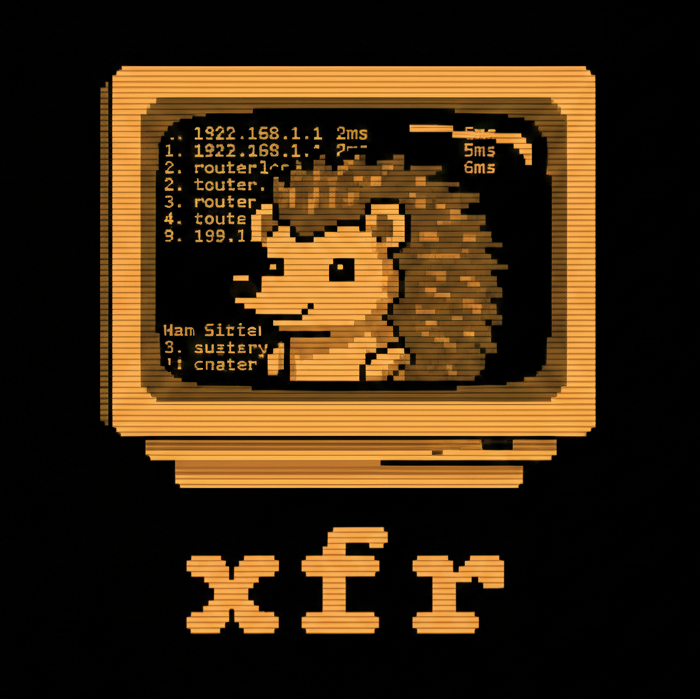
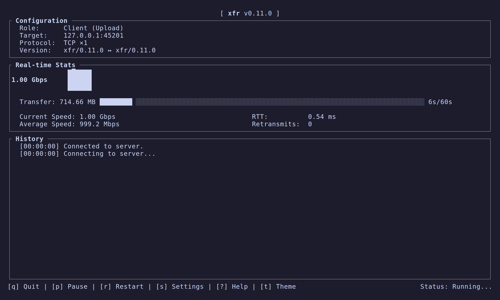

# xfr

<p align="center">
  
</p>

A modern iperf3 alternative with a live TUI, multi-client server, MPTCP, and QUIC support. Built in Rust.

[](https://crates.io/crates/xfr)
[](https://github.com/lance0/xfr/actions/workflows/ci.yml)
[](LICENSE-MIT)
[](https://ko-fi.com/lance0)

[Documentation](docs/README.md) · [Installation](docs/INSTALL.md) ·
[Releases](https://github.com/lance0/xfr/releases) · [Known issues](KNOWN_ISSUES.md)

## Quick Start

```bash
cargo install xfr            # Rust 1.88+; or brew install lance0/tap/xfr
xfr serve                   # On the server
xfr 192.168.1.1              # On the client: TCP, 10 seconds
xfr 192.168.1.1 -P 4         # Four parallel streams
xfr 192.168.1.1 -u -b 1G     # UDP at 1 Gbps
```

Use the same xfr version on both peers for all current features. xfr uses its
own protocol and does not connect to iperf3 servers. Allow port 5201 for TCP
and UDP; see [firewall requirements](docs/SCRIPTING.md#firewall--port-requirements)
for older peers and client source ports.

## TUI Preview

<p align="center">
  
</p>

## Features

- Live client TUI with throughput graphs and per-stream statistics.
- Multi-client server with an optional dashboard: `xfr serve --tui`.
- TCP, UDP, QUIC, and Linux MPTCP; parallel streams and bidirectional tests.
- Plain text, JSON, streaming JSON, and CSV output for automation.
- Saved configuration, LAN discovery, result comparison, and optional Prometheus metrics.
- Both TUIs report status through OSC 7501; unsupported terminals ignore it.

<a id="vs-iperf3"></a>

See the [iperf3 comparison and migration guide](docs/COMPARISON.md).

## Installation

<a id="from-cratesio-recommended"></a>
<a id="homebrew-macoslinux"></a>
<a id="docker-ghcr"></a>
<a id="pre-built-binaries"></a>
<a id="eget"></a>
<a id="arch-linux-aur"></a>
<a id="from-source"></a>
<a id="quick-install-script"></a>
<a id="termux-android"></a>
<a id="nix"></a>
<a id="netbsd"></a>
<a id="optional-features"></a>
<a id="shell-completions"></a>

```bash
cargo install xfr                       # Default features
cargo install xfr --features prometheus # Add metrics support
brew install lance0/tap/xfr             # macOS/Linux
```

[All installation channels and shell completions](docs/INSTALL.md), including
release binaries, Docker, AUR, Termux, Nix, pkgsrc, and source builds.

## Platform Support

Release binaries cover Linux x86_64/ARM64, macOS Apple Silicon, and Android
ARM64. macOS Intel can build from crates.io; NetBSD has a community pkgsrc
package. Native Windows remains experimental; WSL2 is recommended.

CI covers Ubuntu, macOS, and Windows. Packaging and CI coverage do not
establish runtime qualification for every platform or
transport. See [platform details and limitations](docs/INSTALL.md#platform-support).

## Real-World Use Cases

<a id="usage"></a>
<a id="server"></a>
<a id="client"></a>
<a id="udp-mode"></a>
<a id="quic-mode"></a>
<a id="mptcp-mode"></a>
<a id="output-formats"></a>
<a id="interval-control"></a>
<a id="compare-results"></a>
<a id="discovery"></a>
<a id="vpn-tunnel-testing"></a>
<a id="udp-congestion-detection"></a>
<a id="path-mtu-discovery"></a>
<a id="beforeafter-comparison"></a>
<a id="multi-stream-for-bonded-connections"></a>
<a id="prometheus-monitoring"></a>

| Task | Command or guide |
|------|------------------|
| Measure a VPN tunnel | `xfr 10.8.0.1 -t 30s` |
| Download or test both directions | `xfr <host> -R` / `xfr <host> --bidir` |
| Detect UDP congestion | `xfr <host> -u -b 500M -t 60s` |
| Find a path's UDP payload limit | `xfr <host> --probe-mtu`; [UDP sizing](docs/FEATURES.md#udp) |
| Exercise multiple paths/streams | `xfr <host> -P 8 -t 30s`; [MPTCP](docs/FEATURES.md#mptcp-multi-path-tcp) |
| Compare before and after | Save with `-o before.json` / `-o after.json`, then `xfr diff before.json after.json --threshold 5` |
| Find servers on the LAN | `xfr discover` |
| Automate tests and collect metrics | [Scripting, Docker, CI/CD, Prometheus](docs/SCRIPTING.md) |
| Look up flags | `xfr --help`, `xfr serve --help`, [CLI reference](docs/FEATURES.md#cli-reference) |

<a id="keybindings-client-tui"></a>
<a id="keybindings-server-tui"></a>
<a id="themes"></a>

Press `?` / `F1` for TUI help. Client keys include `s` for settings, `t` for
themes, and `p` to pause/resume traffic. See [client keys](docs/FEATURES.md#keybindings-client-tui),
[server keys](docs/FEATURES.md#keybindings-server-tui), and [themes](docs/FEATURES.md#themes).

<a id="configuration"></a>
<a id="prometheus-metrics"></a>
<a id="cli-reference"></a>

Set defaults in the platform configuration directory; CLI values override them.
See [configuration and precedence](docs/FEATURES.md#configuration),
[metrics](docs/FEATURES.md#prometheus-metrics), and the [CLI reference](docs/FEATURES.md#cli-reference).

<a id="security-considerations"></a>
<a id="transport-encryption"></a>
<a id="authentication"></a>
<a id="network-considerations"></a>
<a id="dos-protections"></a>
<a id="server-resource-usage"></a>

TCP and UDP bulk payloads are plaintext. QUIC encrypts traffic but verifies
peer identity only when a PSK is configured. Prefer `--psk-file` to placing a
key in command arguments or environment variables. Read the
[transport security details](docs/FEATURES.md#security-considerations),
[authentication requirements](docs/FEATURES.md#psk-authentication), and
[security policy](SECURITY.md) before exposing a server.

<a id="troubleshooting"></a>
<a id="permission-denied-on-port-5201"></a>
<a id="connection-refused"></a>
<a id="low-throughput"></a>
<a id="udp-packet-loss"></a>

For connection failures, throughput tuning, and UDP loss, start with
[troubleshooting](docs/INSTALL.md#troubleshooting) and [known issues](KNOWN_ISSUES.md).

## Documentation

The [documentation index](docs/README.md) covers installation, features,
automation, architecture, development, release history, and demo sources.

## See Also

- [Terminal Trove](https://terminaltrove.com/xfr/) — xfr listing and discovery
- [AUR](https://aur.archlinux.org/packages/xfr-bin) — community Arch Linux package
- [pkgsrc](https://pkgsrc.se/net/xfr) — community NetBSD package

## Acknowledgments

Special thanks to [Matthieu Baerts (matttbe)](https://github.com/matttbe), Linux kernel MPTCP co-maintainer, for extensive testing, detailed bug reports with packet traces, and feature suggestions including MPTCP support, kernel TCP pacing, zero-copy IO, and high stream-count hardening. xfr is significantly better because of his contributions.

## License

Licensed under either of [Apache License, Version 2.0](LICENSE-APACHE) or [MIT license](LICENSE-MIT) at your option.
